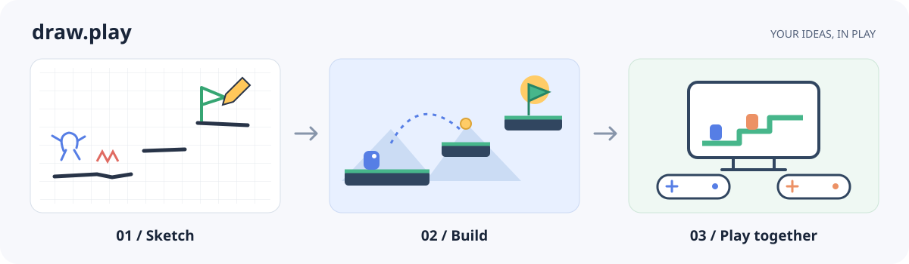
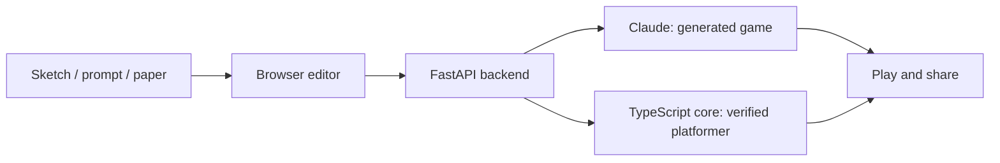

# draw.play

**Sketch it. Build it. Play it.** Turn a drawing or a written idea into a playable browser game, then refine it in chat and share it with friends.



## What you can do

- **Create with AI:** combine a sketch, theme, and gameplay brief. Claude generates a game; follow-up messages change its art and mechanics. Enable **Better graphics** for an extra SVG art pass.
- **Build a faithful platformer:** turn colored ink into platforms, hazards, goals, and collectibles. Preview suggested edits, undo changes, and let a bot check that the level is beatable.
- **Draw on paper:** print templates, scan your sheets, and turn them into levels.
- **Play and share:** publish games, remix levels, race ghosts, or invite a friend to a two-player game. iMessage play is available with the optional Photon Spectrum integration.

## Run locally

You need **Node.js 24+**, **Python 3.11+**, and **uv**. Run these commands from the project root:

```bash
# Install dependencies.
(cd vision && uv sync)
(cd web && npm ci)

# Configure the app, then start the API and frontend.
cp .env.example .env
# Add ANTHROPIC_API_KEY to .env to enable AI game generation.
bash scripts/dev.sh
```

Open **[localhost:5173](http://localhost:5173)**. The API runs on port **8000**; check it at [`/api/v2/health`](http://localhost:8000/api/v2/health). The startup output also includes a LAN address for phones on the same Wi-Fi.

Without an API key, you can play starter levels and use the deterministic faithful builder. AI generation needs the key. Keep credentials in the ignored `.env` file; see [`.env.example`](.env.example) for optional Auth0, artwork, and messaging settings.

## How it fits together



| Folder | What's inside |
| --- | --- |
| `web/` | TypeScript + Vite frontend, Phaser platformer engine, editor, and deterministic game core |
| `vision/` | Python + FastAPI backend, paper vision pipeline, AI generation, and SQLite storage |
| `shared/` | Schemas, starter levels, fixtures, and art packs |
| `messaging/` | Optional Node.js service for Photon Spectrum / iMessage |
| `deploy/vultr/` | Docker Compose and Caddy deployment |

Generated games run in an isolated browser sandbox. Faithful platformers use the shared simulation core for bot checks and replay verification.

## Development

```bash
(cd web && npm run typecheck && npm test && npm run build)
(cd vision && uv run pytest)
```

For the optional messaging service: `(cd messaging && npm ci && npm run typecheck && npm test)`.

Useful guides: [deployment](docs/vultr-launch.md) · [generated multiplayer](docs/generated-multiplayer.md) · [iMessage races](docs/imessage.md) · [level format](docs/spec/level-format-v2.md) · [project background](PROJECT_CONTEXT.md).

## Contributors

- Pranay Joshi
- Gaurav Shrivastava
- Kavya Gupta
