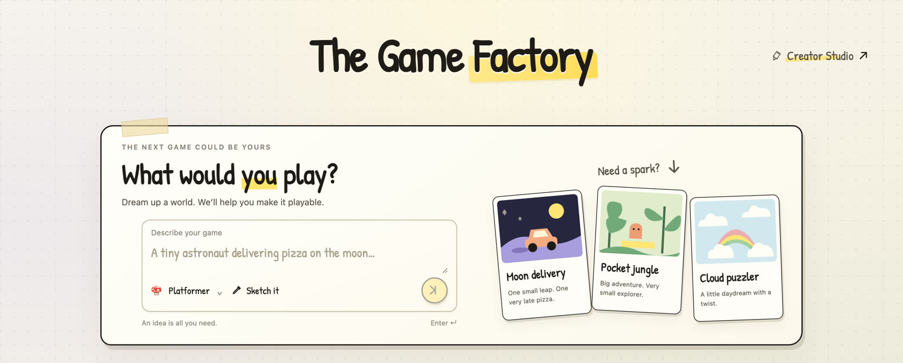
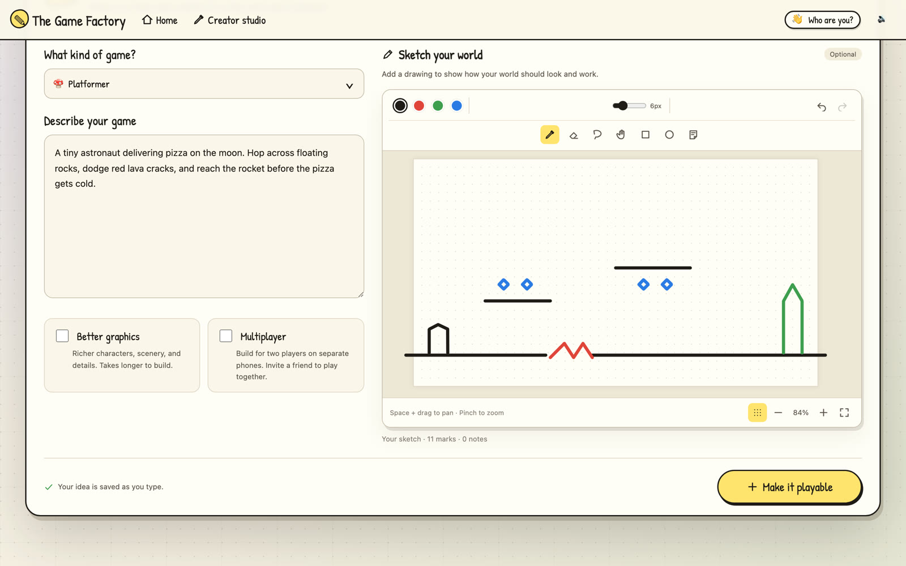
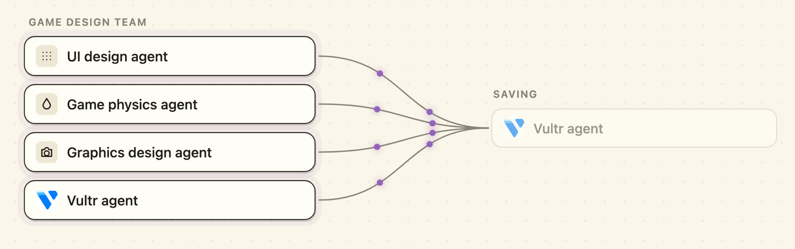
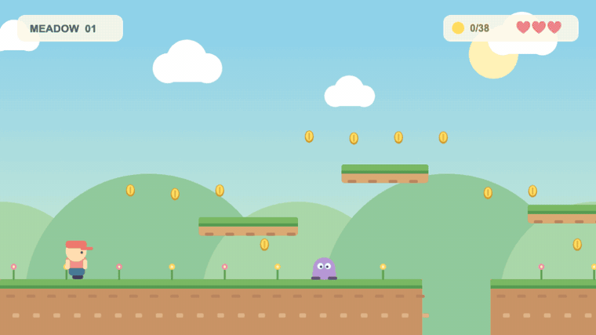
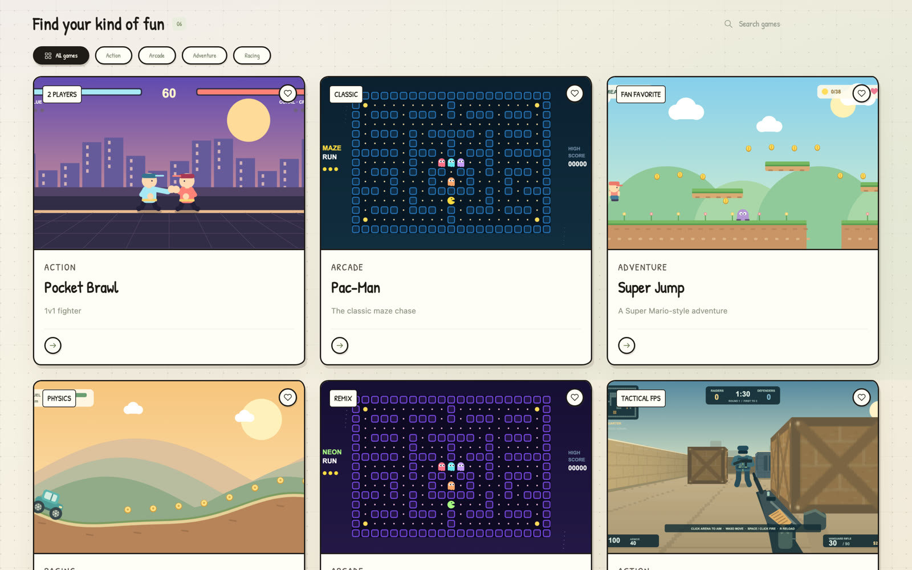

<div align="center">



# The Game Factory

**Dream up a world. We'll help you make it playable.**

Describe a game, sketch your level, and get a game you can play in the browser and share with friends.


</div>

---

## How it works

<table>
<tr>
<td width="50%" valign="top">

### 1. Describe it ✏️
Pick a genre, write your idea, and sketch the world if you like. **Black** ink becomes ground, **red** becomes spikes and enemies, **blue** becomes coins, and **green** becomes the goal.

</td>
<td width="50%"></td>
</tr>
<tr>
<td width="50%"></td>
<td width="50%" valign="top">

### 2. Watch it build 🤖
A team of agents designs the UI, physics, and graphics, then saves your game. Turn on **Better graphics** for richer art, or **Multiplayer** to play with a friend on separate phones.

</td>
</tr>
<tr>
<td width="50%" valign="top">

### 3. Play & share 🎮
Play right away, then refine the game in chat, add levels, remix it, or send it to a friend. You can also race over iMessage.

</td>
<td width="50%"></td>
</tr>
</table>

## The arcade

Start with six built-in games: **Pocket Brawl**, **Pac-Man**, **Super Jump**, **Hill Climb**, **Pac-Man Neon**, and **Breach Point**. Each one runs on phones and desktops.



---

## Quick start

**You need:** [Node.js 24+](https://nodejs.org), [Python 3.11+](https://www.python.org), and [uv](https://docs.astral.sh/uv/).

```bash
# 1. Install dependencies
(cd vision && uv sync)
(cd web && npm ci)

# 2. Add your Claude API key
cp .env.example .env        # then set ANTHROPIC_API_KEY in .env

# 3. Run the app
bash scripts/dev.sh
```

**4. Open [localhost:5173](http://localhost:5173)** 🎉

> [!TIP]
> - **Play on your phone:** the startup output prints a LAN address. Open it on any phone on the same Wi-Fi.
> - **No API key?** The arcade and the sketch-to-platformer builder still work. Only AI game generation needs the key.
> - **Is the API up?** Check [localhost:8000/api/v2/health](http://localhost:8000/api/v2/health).

Optional settings for Auth0 sign-in, Firefly art, and iMessage play are documented in [`.env.example`](.env.example).

## Tests

```bash
(cd web && npm run typecheck && npm test && npm run build)
(cd vision && uv run pytest)
```

## What's inside

| Folder | What it does |
| --- | --- |
| [`web/`](web) | TypeScript + Vite frontend, arcade games, Phaser platformer engine, and sketch editor |
| [`vision/`](vision) | Python + FastAPI backend, Claude game generation, paper-scan pipeline, and SQLite storage |
| [`shared/`](shared) | Schemas, starter levels, and art packs |
| [`messaging/`](messaging) | Optional iMessage service (Photon Spectrum) |
| [`deploy/vultr/`](deploy/vultr) | Docker Compose + Caddy production deploy |

Generated games run in an isolated browser sandbox.

**More guides:** [Deploying](docs/vultr-launch.md) · [Multiplayer](docs/generated-multiplayer.md) · [iMessage races](docs/imessage.md) · [Level format](docs/spec/level-format-v2.md)

## Team

Built by **Pranay Joshi**, **Gaurav Shrivastava**, and **Kavya Gupta**.
