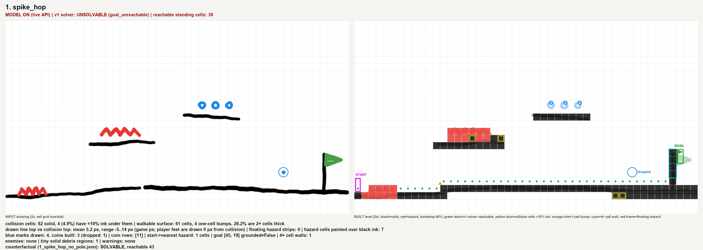
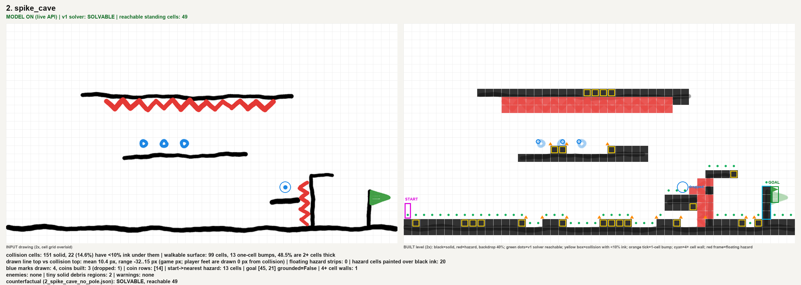
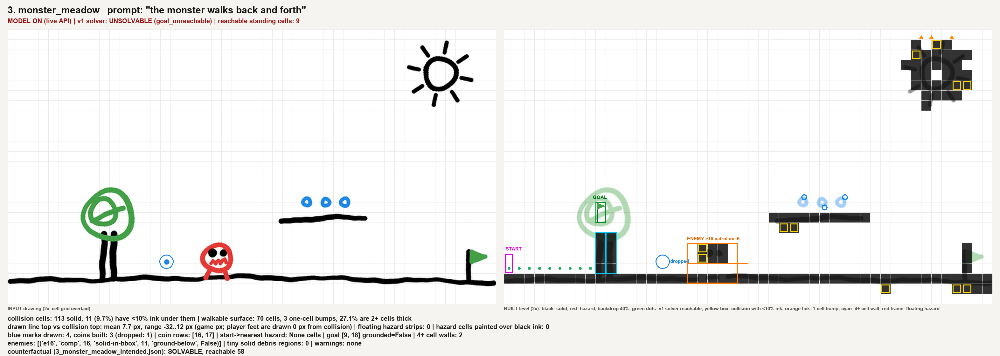
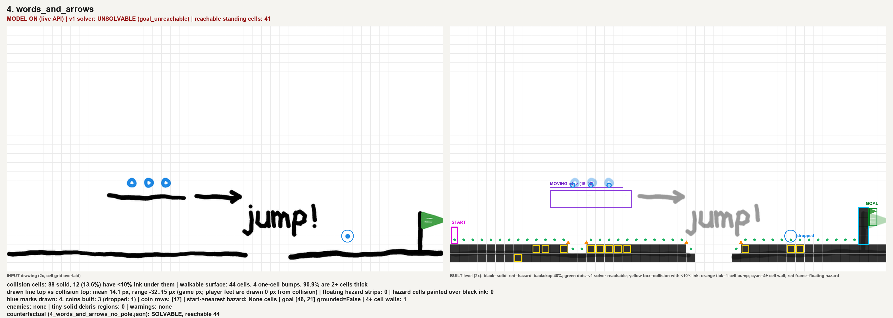
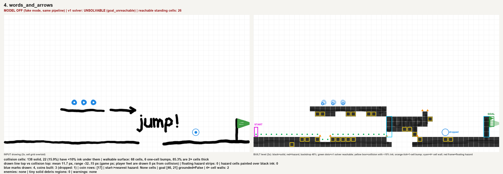
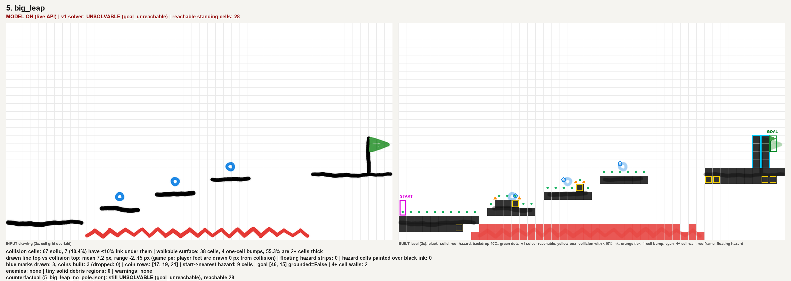
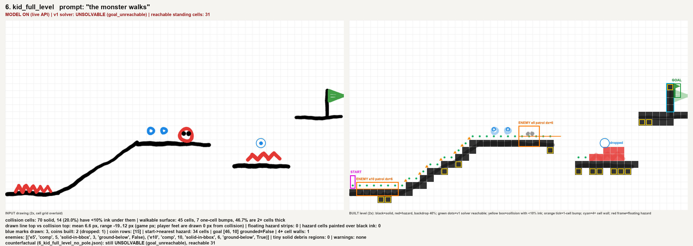

# Diagnosis 1: build quality (drawing -> level)

The owner said: *"how it's built after I draw is extremely poor quality"* and *"what I draw is placed on the game board without any thought."* This report checks that claim with six realistic kid drawings sent through the live v1 API, and traces every failure to a line of code.

## Summary

- **5 of 6 drawings built into levels that cannot be beaten.** v1's own solver (`web/src/solver/solve.ts`, run on the API output) reports `goal_unreachable` for drawings 1, 3, 4, 5 and 6. In 3 of those 5 (drawings 1, 3 and 4), the drawing is fine and the build broke it. A counterfactual that only undoes the build error (the flag pole is scenery, or the tree is scenery) makes the level solvable.
- **The single biggest killer is the goal flag.** A kid draws a black pole with a green flag. v1 turns the pole into a 4 to 5 cell solid wall, which is higher than the 3.8-cell maximum jump, and puts the goal on the far side of it. This happened in **all 6** drawings.
- **Decoration becomes terrain and can steal the goal.** In drawing 3, the green tree canopy is the largest green blob, so it *became the goal*. Its black trunk became a 4-cell wall 9 cells from spawn that boxes the player into 9 standing cells. The sun became a cluster of solid blocks in the sky.
- **Every drawn line turns into a staircase and a bumpy floor.** A flat-looking floor yields 4 to 13 one-cell bumps per level. Arcade physics has no step-up, so each bump stops the player and forces a jump. Between 26% and 91% of walkable surface cells are 2 or more cells thick, from an 8 px pen. Whether a line becomes 1 or 2 rows depends only on where it falls inside a 16 px cell (3 of 8 phases give 2 rows).
- **Spikes are measured, not understood.** A 13 px zigzag always becomes a 32 px (2-row) hazard block. With a drawn gap of 0 px the spikes eat the platform's top row. With a gap of 24 px or more they float as a detached strip. They have no orientation and no "resting on platform N". In drawing 2, the spikes drawn on a wall's face turned the wall itself into hazard (20 hazard cells over black ink).
- **Taps vanish.** A single brush tap (8 px, exactly what the canvas paints) is below the 0.3-cell minimum area. It is dropped from the level *and* erased from the backdrop. This happened in 5 of 6 drawings.
- **Art and collision disagree.** A drawn line's top edge and the collision surface the player stands on are 4 px or more apart on 56% to 96% of surface cells (mean 5 to 14 px at game scale). Collected coins stay painted on the backdrop. The engine's goal flag is drawn where the goal entity is, not where the kid drew it. Moving a monster cuts a notch out of the floor art and leaves its eyes behind as floating dots.
- **The "mind" is not asked to think.** The vision model is told its *only job* is to read words and arrows and "never invent geometry" (`vision/app/llm/prompt.py:26`). It is never asked what objects are (decoration, flag pole, monster with eyes), how they relate (spikes resting on platform 4), or whether the result plays. No repair stage exists anywhere. The server never solves (`meta.solvable` is always `null`). The browser just says "Goal can't be reached" and still lets you publish.

With the model off (no key, a 20 s timeout or a refusal), the same pipeline also turns handwriting into terrain. "jump!" became a solid block whose `j` descender walls off the path, and the arrow fused onto the platform (drawing 4, model off: reachable cells drop from 41 to 26).

## Method (reproducible)

All files are under `docs/v2/diagnosis/build/`.

| Step | Script / artifact |
|---|---|
| 1. Six realistic 768x432 canvas drawings: wobbly 6.5 to 9.5 px round strokes, the exact canvas palette, 4x supersampled then downsampled so edges anti-alias like an HTML canvas | `make_kid_drawings.py` -> `inputs/1..6_*.png`, `inputs/manifest.json` (the intended meaning of every mark) |
| 2. Live API, model ON: `curl -F image=@.. -F mode=canvas -F debug=true [-F prompt=..] http://localhost:8000/api/scan` | `responses/<stem>.json` (latency 2.3 to 9.8 s, all HTTP 200, no warnings) |
| 3. API images fetched: `backdrop.png`, `drawing.png`, `annotated.jpg`, `comp_*.png` | `api_out/<stem>/` |
| 4. Same pipeline in-process with the model OFF (`DAL_FAKE_LLM=1`) | `run_offline.py` -> `offline/<stem>/` |
| 5. Render input against the built level at 2x, measure, and run v1's own TS solver plus counterfactuals | `render_compare.py`, `solve_levels.ts` -> `compare_<n>.png`, `compare_<n>_model_off.png`, `cf/*.json`, `metrics.json` |
| 6. Controlled sweeps through `analyze_drawing` to isolate causes | `probe_sweeps.py` -> `probe_sweeps.json` |

How to read the compare images:
- **Left:** the input drawing.
- **Right:** the built level.
  - Black cells are solid and red cells are hazard, over the API backdrop at 40%.
  - Green dots are standing cells the v1 solver can reach.
  - Yellow boxes are collision with less than 10% ink under it (invisible wall).
  - Orange ticks are 1-cell bumps.
  - Cyan boxes are walls of 4 or more cells (unjumpable).
  - Blue rings mark drawn marks that were dropped.
  - Orange and purple frames are enemies and moving platforms.

## Scoreboard

| # | Drawing | v1 solver on the API level | Counterfactual (undo only the build error) | Coins drawn -> built | 1-cell bumps | Surface 2+ thick | Collision with <10% ink | Headline failure |
|---|---|---|---|---|---|---|---|---|
| 1 | spike_hop | **unsolvable** (39 cells reachable) | pole removed -> **solvable** | 4 -> 3 | 4 | 26% | 4.9% | flag pole = 5-cell wall in front of the goal; spike hitbox 2.5x the art; spawn 1 cell from spikes |
| 2 | spike_cave | solvable (49) | (pole removed) solvable | 4 -> 3 | **13** | 49% | 14.6% | bumpy floor; wall spikes turned the wall into hazard (20 cells); ceiling spikes 2 rows deep |
| 3 | monster_meadow | **unsolvable (9 cells)** | flag is the goal, trunk and pole scenery -> **solvable** (58) | 4 -> 3 | 3 | 27% | 9.7% | tree canopy became the GOAL; trunk walls off the level; sun = solid blocks; monster's eyes left as solid tiles |
| 4 | words_and_arrows | **unsolvable** (41) | pole removed -> **solvable** | 4 -> 3 | 4 | 91% | 13.6% | goal behind its own pole; model off: "jump!" and the arrow become terrain (reachable 26) |
| 5 | big_leap | **unsolvable** (28) | pole removed -> still unsolvable (the 7-cell gap is real) | 3 -> 3 | 4 | 55% | 10.4% | impossible final gap built silently; rest of the level trivial; also pole wall |
| 6 | kid_full_level | **unsolvable** (31) | pole removed -> still unsolvable (goal platform out of reach) | 3 -> 2 | 7 | 47% | 20.0% | ramp -> 9-step staircase; "the monster walks" also made the **spawn spikes** walk; no nudge for impossible jumps |

All numbers are in `build/metrics.json`. "Coins built" counts what the API returned. The dropped mark is the tap in each case.

## The images

### 1. spike_hop

- The floor slopes about 1.5 cells across the left half. This produced 4 one-cell steps, and 26% of surface cells are double thick. The accidental 12 px gap was closed by dilation. That is luck, not design: the same mechanism opens holes elsewhere (see drawing 2).
- The spikes drawn about 1 cell above platform 1 became a 6x2 hazard block on top of the platform (`^^^#^^##` in row 16). The drawn zigzag is 13 px tall; the hitbox is 32 px.
- Spawn is at `(0,23)` and hazard starts at x=1. The spawn is never cleared.
- The **tap coin at (622,340) is gone** from the level and from the backdrop: the backdrop pixel there is pure white.
- The **flag pole is a 5-cell wall (col 44, rows 18-22)**. The goal entity `(45,19)` is behind it and in mid-air (`goal_grounded=false`). The level is unsolvable. Remove only the pole cells and it becomes solvable.

### 2. spike_cave

- The wobbly floor became rows 24 and 25 with holes in row 24: **13 one-cell bumps** along the main path. The player must hop every few cells.
- The ceiling spikes are a 2-row hazard block and do not point down. The wall's spike face made the wall column itself hazard (`hazard_cells_over_black_ink = 20`), because hazard always wins over solid in a cell.
- The level is solvable only via the wall lip: the solver jumps from the step to the lip and over the 4-cell pole wall. The intended path along the floor to the flag is blocked by the pole.

### 3. monster_meadow (prompt: "the monster walks back and forth")

- **The goal is the tree.** `pipeline.py` takes the largest green blob as the goal, so the canopy (28 cells) beat the real flag (3 cells). The goal sits in mid-air at `(9,18)`.
- **The trunk is a 4-cell solid wall at cols 9-10**, so the player is boxed into 9 standing cells. The sun is 9 solid components floating in the sky. The real flag's pole is another wall.
- The model correctly bound `patrol` to the monster (comp 16). The monster's **black eyes are separate black components that stay behind as solid tiles** (rows 21-22, cols 19-21) when the monster walks away. The enemy bbox `[18,21,22,24]` includes the floor row (11 solid cells inside its bbox).
- In the backdrop, whitening the monster's dilated mask **erased 8 columns of the floor line** (x 307-348 px) and left the eyes floating (207 dark pixels). See `api_out/3_monster_meadow/backdrop.png`.
- The monster crop `comp_16.png` has dark fringes from neighbouring eye and floor ink, because the crop mask is `MaxFilter(5)`-dilated.
- The counterfactual (goal at the drawn flag, trunk and pole as scenery) is **solvable with 58 reachable cells**.

### 4. words_and_arrows (no prompt; model ON)

- The model did well here. It marked "jump!" and the arrow as annotations and bound `move dx=+8` to the platform. Note this is the only thing the model is allowed to do.
- The level is still **unsolvable because of the flag pole** (col 45, rows 20-23, 4 cells). Removing the pole makes it solvable. The moving platform is 2 rows thick (`bbox [11,18,19,19]`) for an 8 px line.

- **Model off** (no key, timeout or refusal, which v1 treats as normal): "jump!" became a 3-row solid block. The `j`'s descender connects it to the floor as a 4-cell wall at col 26 that blocks the path. The arrow fused onto the platform and extended it by 6 cells. Solid cells rise from 88 to 138, and reachable cells fall from 41 to 26.

### 5. big_leap

- The first three hops are 2-cell gaps with 2-cell rises, which is trivial. The final gap is 7 empty cells (drawn 8). The engine clears at most 6. The build silently ships it: no warning, `meta.solvable: null`.
- The goal also sits behind a 2-wide, 4-tall pole wall. Removing the pole still leaves the level unsolvable. Here the kid's geometry is the problem, and v1 has no "nudge impossible jumps" repair or explanation.
- The "lava" zigzag became 2 rows of hazard (rows 25-26), which is reasonable.

### 6. kid_full_level (prompt: "the monster walks")

- The diagonal ramp became a **9-row staircase** with 7 one-cell bumps on the main path. 20% of the collision cells have less than 10% ink under them, mostly the staircase's under-steps.
- **"the monster walks" produced two walking enemies.** The model bound patrol to the monster (comp 5). The keyword heuristic, merged on top, independently bound patrol to the *largest* red component, which is the **spawn spikes** (comp 10). The spikes now walk 6 cells right from x=1, starting 1 cell from the player's spawn. With the model off, only the spikes walk and the monster stays a static hazard.
- The monster's bbox includes the platform row (3 solid cells inside it), so the patroller is drawn sunk into the line. Its eyes (comp 6) were marked as an annotation, so they leave the grid but stay on the backdrop while the monster walks away.
- The spikes over platform 2 cover 5 of its 9 cells as a 2-row block. The goal platform is 7 rows above platform 2, and 4 rows up and about 12 cells across from the top platform. v1 just reports unsolvable and suggests nothing.

Other API images worth opening:
- `build/api_out/*/annotated.jpg`: what the model sees. It is the *cleaned* drawing, so dropped taps are already gone before the model looks.
- `build/api_out/3_monster_meadow/backdrop.png`: the floor notch and the orphaned eyes.
- `build/api_out/6_kid_full_level/comp_10.png`: the spawn spikes cropped as a walking sprite, with a dark floor fringe.

## Controlled sweeps (`build/probe_sweeps.json`)

These sweeps run the canvas-mode CV directly, one variable at a time.

| Sweep | Result | Meaning |
|---|---|---|
| Blue tap diameter 6 / 8 / 10 / 12 / 20 px | coin: no / **no** / yes / yes / yes | The canvas brush is 8 px, so **a tap never registers**. The cutoff is about 9.9 px, from `MIN_AREA_CELLS = 0.3`. |
| 8 px horizontal line, centre at each 2 px phase inside a 16 px cell | 1 row in 5 phases, **2 rows in 3 phases** | Thickness and surface height depend on sub-cell luck. The surface can sit up to about 12 px above the drawn ink. |
| 13 px red zigzag, base G px above an 8 px platform; G = 0 / 6-20 / 24-48 | hazard rows 16-17 with solid 17 (eats the platform top) / attached 2-row block / **detached 2-row strip floating 1 row up** | The hazard is always 32 px tall. There is no notion of "spikes rest on this platform", so the outcome flips on a few pixels. |
| 8 px line rising R px over 400 px; R = 0 / 8 / 16 / 32 / 64 / 128 | steps 0 / 0 / 1 / 2 / 4 / 8 | Any slope over about 1 cell becomes a staircase that must be jumped step by step. |

## Failure catalogue with root causes

Line numbers refer to v1 as committed (`1db31c9`).

| # | Failure | Seen in | Root cause (file:line) |
|---|---|---|---|
| F1 | **Flag pole becomes a wall in front of the goal; goal floats behind it** | 1, 2, 3, 4, 5, 6 (blocks 1, 4; contributes in 3, 5, 6) | A black pole is just black ink, so it is solid (`vision/app/cv/components.py:95-100`). The goal is the green centroid cell, with no grounding and no relation to the pole (`vision/app/cv/pipeline.py:140-144`). The compiler copies it unvalidated (`vision/app/compile.py:586-590`). |
| F2 | **Decoration becomes terrain or the goal** (tree canopy = goal, trunk = wall, sun = sky blocks) | 3 | Goal = *largest* green component (`pipeline.py:142`). Every black component is geometry unless the model lists it as an annotation. The prompt defines annotations only as "letters, arrows, labels" and forbids judging geometry (`vision/app/llm/prompt.py:26`, `:43`). There is no "decoration" role anywhere. |
| F3 | **Handwriting and arrows become terrain when the model is off** | 4 (model off) | Removal of text depends 100% on `annotation_component_ids` from the model (`compile.py:394-408`). The fake-mode heuristic never sees the image and returns `annotation_component_ids=[]` (`vision/app/llm/heuristic.py:200-207`). The PLAN's fallback ("drop black components under 4 cells with no neighbors") was never implemented. |
| F4 | **Staircases, bumps and double-thick platforms** from wobbly or sloped lines | all (4 to 13 bumps; 26% to 91% double thick) | Per-cell coverage threshold on a dilated mask: `dilate_for_coverage` grows strokes by cell/4 (`vision/app/cv/segment.py:59-64`), then `COVERAGE_THRESHOLD = 0.25` (`components.py:20`, `:96`). A stroke is never reduced to a centreline or fitted to a line, and there is no surface straightening. Arcade physics has no step-up, so every bump costs a jump. |
| F5 | **Spike hitbox inflated to 2 rows; spikes eat the platform top or float detached; no orientation** | 1, 2, 5, 6, sweep | The same coverage rule for red, and "hazard wins" over solid in a cell (`components.py:97-100`). Spikes are cells, not objects: no "rests on", no "points up/down/left". |
| F6 | **Wall spikes convert the wall into hazard** | 2 (20 cells) | `components.py:100`: `"2" if hazard else "1" if solid`. The dilated red strip covers the adjacent wall column. |
| F7 | **Single taps dropped from the level and erased from the backdrop** | 1, 2, 3, 4, 6 | `MIN_AREA_CELLS = 0.3` (`components.py:19`, enforced at `:68-71`) is larger than an 8 px brush dot (canvas `BRUSH_PX = 8`, `web/src/screens/canvas.ts:21`). `cleaned_drawing` keeps only surviving components' ink (`pipeline.py:170-178`), so the tap disappears from the art as well. |
| F8 | **Monster's eyes left behind as solid tiles; floor art notched where the monster was** | 3, 6 | Eyes are black components separate from the red monster (`components.py:63-83`, per-colour CC). Compile clears only the bound component's cells (`compile.py:396-408`). `_component_mask` dilates 2 px (`compile.py:283-286`) and `_whiten_mask` paints white over neighbouring floor ink (`compile.py:310-314`, `:445`). |
| F9 | **Enemy bbox overlaps the ground; enemies float and have no gravity** | 3 (11 solid cells in bbox), 6 | The patrol entity uses the raw component bbox (`compile.py:541-553`) with no grounding. `Patroller` disables gravity (`web/src/game/behaviors/Patroller.ts:6`, `:38`). |
| F10 | **"the monster walks" binds patrol to the spawn spikes too** | 6 (live and offline) | The typed prompt is run through the heuristic even when the model answered, and merged per component (`vision/app/llm/interpret.py:154-155`, `:56-59`). The heuristic picks the *largest* red (`heuristic.py:102-107`, `:173-174`), unaware of what the model bound. |
| F11 | **Spawn placed next to hazards** | 1 (1 cell), 6 (enemy starts at x=1) | Start = top of the leftmost solid column (`pipeline.py:113-118`, `:155`; `compile.py:582-584`). There is no clearance check. |
| F12 | **Impossible or trivial levels ship silently** | 1, 3, 4, 5, 6 unsolvable; 5 trivially easy before the final gap | The server never solves: `Meta(solvable=None)` (`compile.py:638`). The browser solver only paints an overlay ("Goal can't be reached", `web/src/screens/preview.ts:140-175`) and does not explain, repair or block publishing. Nothing measures difficulty, rhythm or checkpoint spacing. |
| F13 | **Art and collision misaligned** (drawn line top vs standing surface off by 4 px or more on 56% to 96% of surface cells; collision with <10% ink 5% to 20%) | all | Collision is a thresholded, dilated 16 px grid, while the art is the raw backdrop (`pipeline.py:308-312`). Neither is derived from the other or snapped. |
| F14 | **Coins and goal drawn twice; collected coins stay painted** | all | The backdrop keeps the drawn coins and flag (`pipeline.py:170-178`). The engine adds its own coin glyphs at cell centres and its own flag at the goal cell (`web/src/game/LevelScene.ts:226-249`). The coin's cell centroid snaps to a cell, so glyph and drawing are offset; collecting removes only the glyph. In drawing 3 the engine's flag appears on the tree. |
| F15 | **Dirty dynamic-object crops** (eye and floor fringe in the monster and spike sprites) | 3, 6 | The crop alpha comes from the dilated label mask, plus every non-white pixel in the box (`compile.py:289-300`). |
| F16 | **Crunchy backdrop** | all (engine) | `pixelArt: true` (`web/src/game/index.ts:68`) nearest-neighbour scales the 768x432 hand drawing. |
| F17 | **The model is not asked to perceive or judge** | all | System prompt: "Your only job is to read the words, arrows and labels … Never report coordinates and never invent geometry" (`prompt.py:26`). The model sees component ids and bboxes but has no vocabulary for roles (decoration, flag pole, eyes-of-monster), relations (resting-on, attached-to, pointing) or repairs, so it cannot fix F1 to F11 even when it plainly sees them. It also only sees the cleaned drawing (`pipeline.py:316-323`), after taps were already removed. |

## Why quality is poor (synthesis)

1. **Pixels are turned into cells before anything understands objects.** The pipeline is colour, then connected components, then per-cell coverage, then a grid. Meaning (spike, monster, flag, tree, word) is never attached to geometry, so each cell is decided by a 25% threshold on a dilated mask. Staircases, double-thick lines, inflated spikes, invisible walls and dropped taps all come from this rule.
2. **Colour is the only semantic.** Black is ground, so poles, trunks, suns, eyes, letters and arrows are ground. Green is the goal, so the biggest green thing wins. Red is hazard, so a monster's outline is hazard and wall-face spikes swallow the wall.
3. **The AI is boxed into transcription.** The one component that could tell a tree from a platform, or a flag pole from a wall, is told not to think about geometry, and its only lever is "annotation or not". There is no fixed vocabulary of *repairs* for it to propose.
4. **There is no build-time validation loop.** The solver exists but runs only in the browser as an overlay. The server ships `solvable: null`, nothing explains *why* a level fails, nothing proposes a fix, and nothing measures whether a level is interesting (the solvable levels are flat walks with an occasional hop).
5. **Art and physics are two unrelated derivations of the same pixels**, so what the player stands on is not what they see. The engine then adds a second set of coins and flags on top.

## Direction for v2 (from this evidence)

- **Perceive objects, not cells.** Have the vision model return typed objects: platform (with centreline), spike strip (with host surface and facing), wall, enemy (with parts: eyes and mouth belong to it), goal flag (pole + flag as one object), coin, decoration, text, arrow. Each object references CV component ids; CV supplies exact pixels.
- **Fit geometry, then rasterize.** Collapse each stroke to its centreline and fit runs to straight or gently sloped segments. Place exactly one collision row at the ink's top edge, so the surface meets the ink to within 2 px. Render slopes as walkable ramps (or 1-cell steps the engine auto-climbs). Spikes become a 1-row hazard on the host surface's face, oriented away from it.
- **Repair in a fixed, undoable vocabulary.** Examples: `snap_spikes_to_surface`, `straighten_platform`, `close_gap(<=1 cell)`, `ground_goal`, `pole_is_scenery`, `clear_spawn(radius 3)`, `merge_part_into(eyes -> monster)`, `mark_decoration`, `nudge_platform(to make the jump <= 6 cells)`. The model proposes; deterministic code applies, re-solves server-side, and shows each edit with a one-line reason and a toggle.
- **Never drop ink silently.** A tap becomes a coin (blue dots smaller than 0.3 cell count). Anything not used becomes decoration that stays visible.
- **Playtest at build time.** Run the solver (ported or shared) on the server. Store `solvable`, the critical path, max jump used, blind drops and dead ends. Feed that back to the model for a second repair pass, and to the creator as plain-language notes ("the last jump is 7 cells, the max is 6; move this platform 2 cells left?").
- **One source of truth for art.** Erase drawn coins and flags from the backdrop once they become entities, and crop sprites from the object mask, not a dilated box. Ground enemies with gravity, or snap them to the host surface.
- **Text never becomes terrain, even offline.** Add a CV-only text and arrow detector (dense small black components with many holes, or ink without a horizontal run) as a fallback. Typed prompts must bind to the object the model chose, not "the largest red".
